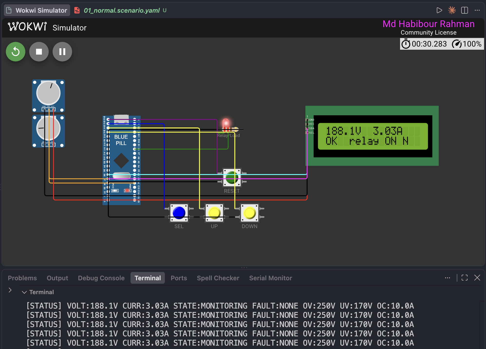
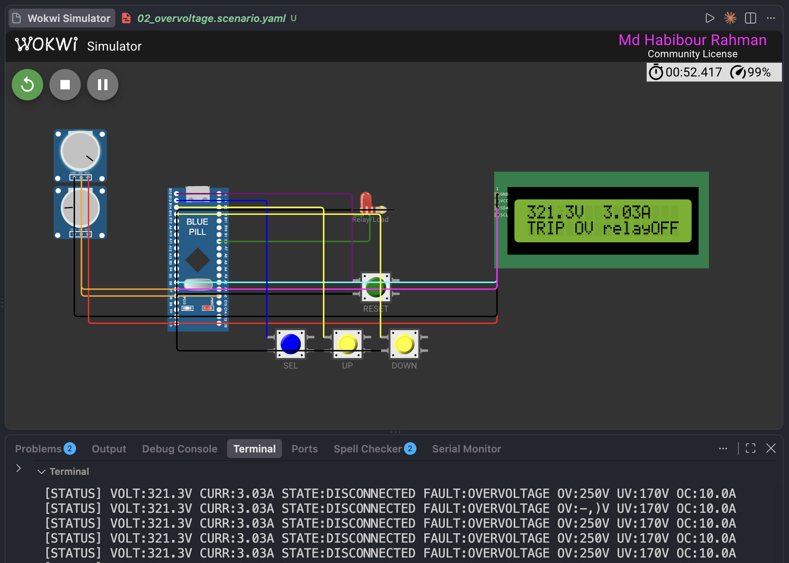
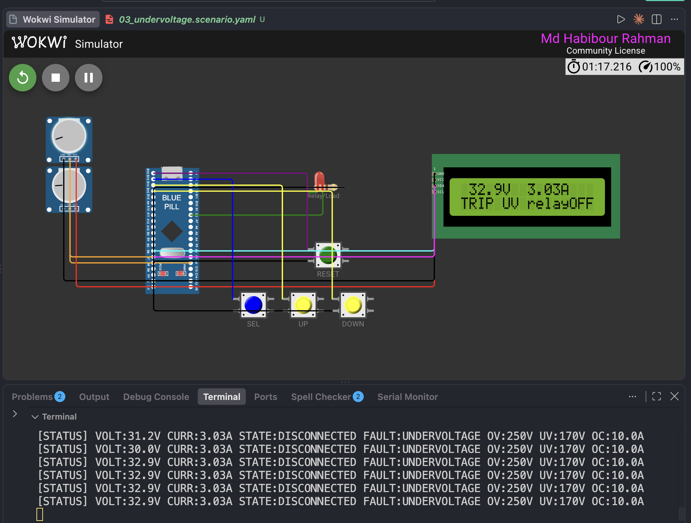
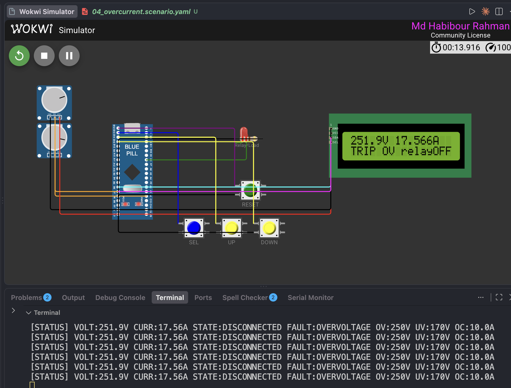
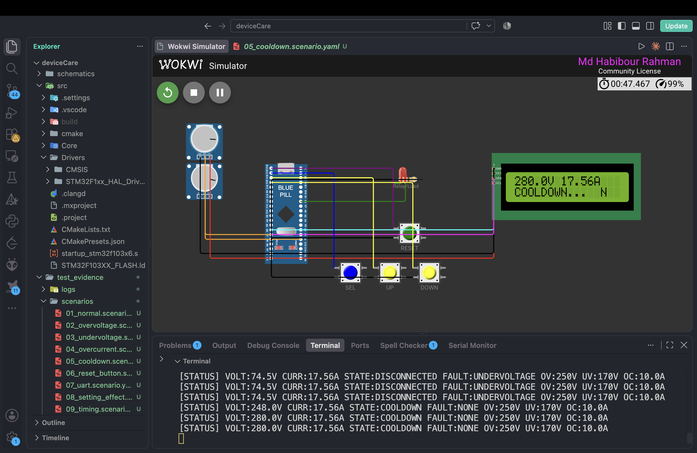
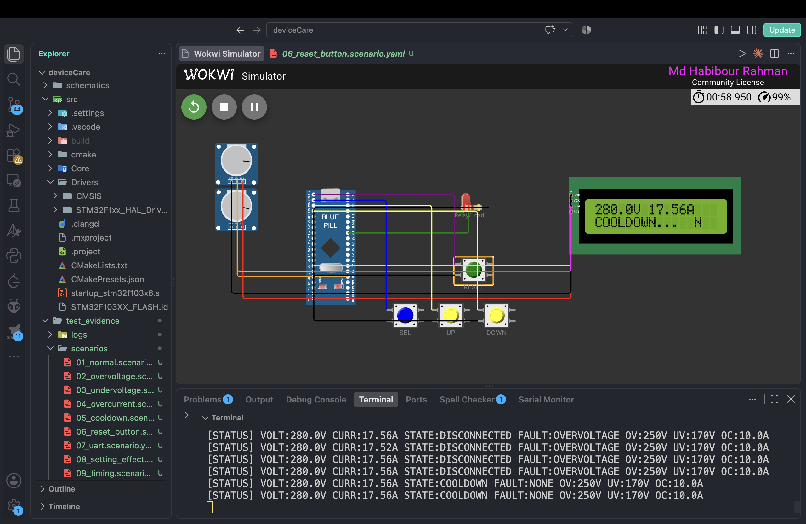
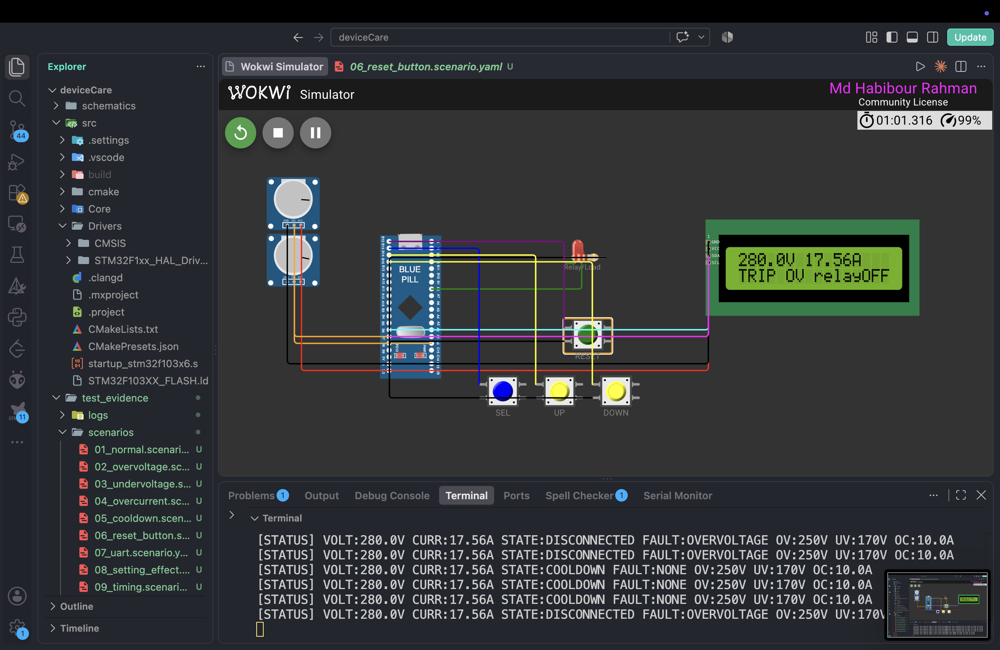
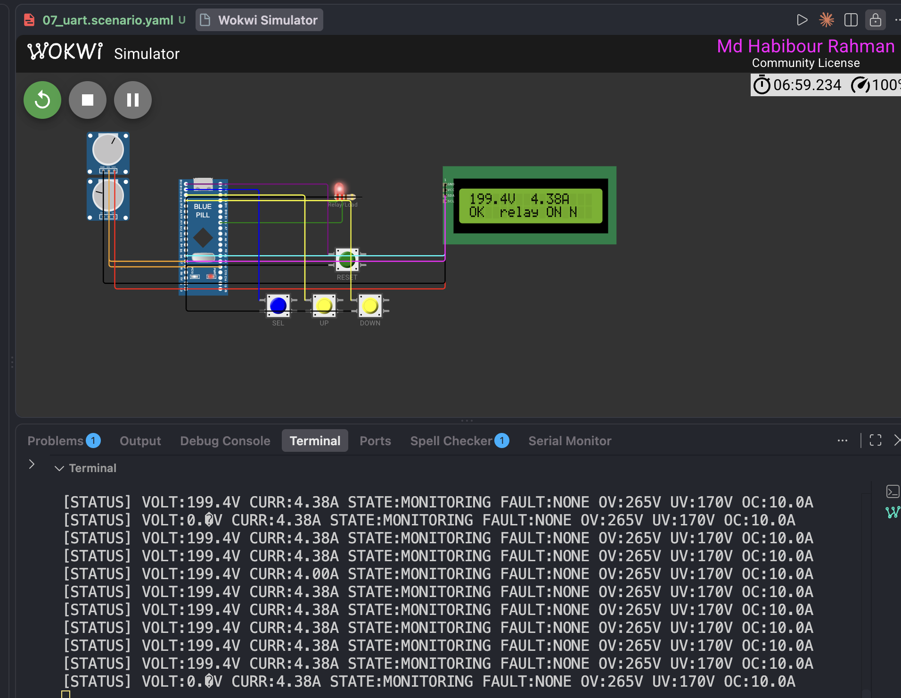

# deviceCare - Voltage Protector (STM32F103 Blue Pill)

Microcontroller-based protector that disconnects a load (relay) on overvoltage,
undervoltage or overcurrent, with settings changeable on the device or from a computer.

## How to run

The project runs in the Wokwi simulator inside VS Code. No hardware is needed.

**1. Install**

- `arm-none-eabi-gcc`, CMake >= 3.22, Ninja
- VS Code with the *Wokwi Simulator* extension, then `F1` -> *Wokwi: Request a Free License*

**2. Build the firmware**

```bash
cd src
cmake --preset Debug
cmake --build --preset Debug
```

This produces `src/build/Debug/voltage_protector_2.elf`, which `project_files/wokwi.toml` points at.

**3. Start the simulation**

1. Open the `project_files/` folder in VS Code.
2. `F1` -> *Wokwi: Start Simulator*.
3. Open the **Terminal / Serial Monitor** panel to see the `[STATUS]` line (115200 8N1, once per second).

**4. Drive it**

| Part in the simulator | What to do | Effect |
|---|---|---|
| Top potentiometer (PA0) | Turn it | Voltage input, 0-100 % = 0-330 V |
| Bottom potentiometer (PA1) | Turn it | Current input, 0-100 % = 0-20 A |
| Red LED "Relay/Load" (PB0) | Watch it | Lit = load connected, off = disconnected |
| LCD | Watch it | Live V / A, state and fault |
| SEL / UP / DOWN | Click | Choose and change a limit (see [On-device UI](#on-device-ui)) |
| RESET (green) | Click while faulted | Skip straight to COOLDOWN |

Quick tries with the default limits (OV 250 V, UV 170 V, OC 10 A):

| To see | Set |
|---|---|
| Normal operation | voltage pot about 70 % (231 V), current pot about 25 % (5 A) |
| Overvoltage trip | voltage pot above 76 % |
| Undervoltage trip | voltage pot below 51 % |
| Overcurrent trip | current pot above 50 %, with voltage kept inside 170-250 V |
| Cooldown | clear the fault; relay stays off for 3 s, then reconnects |

**5. (Optional) Run the automated scenarios**

Headless, with `wokwi-cli`. Needs a token from <https://wokwi.com/dashboard/ci>.

```bash
export WOKWI_CLI_TOKEN=<your token>
test_evidence/run_all.sh
```

Logs go to `test_evidence/logs/`, timing captures to `test_evidence/timing/`. Details and results are in
[test_evidence/README.md](test_evidence/README.md).

## Features

Screenshots are in [test_evidence/screenshots/](test_evidence/screenshots/).

### Normal operation

Voltage and current inside the limits: state MONITORING, relay on, LCD shows `OK relay ON`.



### Overvoltage protection

Voltage above 250 V: relay drops, LCD shows `TRIP OV relayOFF`, status line reports `FAULT:OVERVOLTAGE`.



### Undervoltage protection

Voltage below 170 V: relay drops, LCD shows `TRIP UV relayOFF`, status line reports `FAULT:UNDERVOLTAGE`.



### Overcurrent protection

Current above 10 A drops the relay. Voltage is checked first, so when both are out of range the fault shown is
the voltage one. In this capture voltage was 251.9 V as well, so the LCD shows `TRIP OV`; the overcurrent-only
case is in `test_evidence/logs/04_overcurrent.log`.



### Cooldown before reconnecting

Once the reading is back in range the relay stays off for 3 s (`STATE:COOLDOWN`), then reconnects.



### Manual reset button (PB12)

Pressing RESET while faulted goes straight to COOLDOWN (first image). If the fault is still present when the
cooldown ends, the device trips again (second image).




### Settings

Limits can be changed on the device with SEL / UP / DOWN, or over UART. The status line always prints the active
limits; in this capture OV has been changed from 250 V to 265 V.



### Feature summary

- Fault detection: overvoltage (default 250 V), undervoltage (170 V), overcurrent (10 A)
- Relay output on PB0 disconnects the load on any fault
- State machine: MONITORING -> DISCONNECTED -> COOLDOWN (3 s) -> MONITORING
- Manual reset button (PB12)
- Settings on the device: SEL / UP / DOWN buttons (PB13 / PB14 / PB15) and a 16x2 I2C LCD (PB6 SCL, PB7 SDA)
- Settings from a computer over UART (USART1, PA9 TX / PA10 RX, 115200 8N1)
- Status line printed every second; heartbeat LED on PC13 blinks 1 s normally, 200 ms in fault

## Serial commands

End each command with Enter (CR or LF).

| Command | Effect |
|---|---|
| `SET_OV:<V>` | Overvoltage limit |
| `SET_UV:<V>` | Undervoltage limit |
| `SET_OC:<A>` | Overcurrent limit |
| `STATUS` | Print status now |
| `RESET` | Same as the reset button |
| `HELP` | List commands |

Limits are kept in RAM only and return to defaults after a restart.
OV must be above UV and at most 330 V; OC must be above 0 and at most 20 A.

## On-device UI

SEL cycles: view -> set OV -> set UV -> set OC -> view. UP / DOWN change the
value (5 V steps for OV/UV, 0.5 A for OC). Returns to the view after 10 s idle.

## Repository layout

| Path | Content |
|---|---|
| `src/` | Firmware (STM32 HAL, CMake project) |
| `project_files/` | Wokwi simulation (`diagram.json`, `wokwi.toml`) |
| `schematics/` | Schematic / block diagram of the real product |
| `test_evidence/` | Scenarios, screenshots, logs, timing captures |
| `design_report.pdf` | Design document |

## Limitations

- Fault checking is polled in the main loop every 100 ms, not interrupt-driven.
- Buttons are polled (20 ms sampling, edge-triggered); the RESET button is read on the 100 ms sample.
- Settings are not stored in flash.
- No hardware watchdog.
- UART command input could not be verified in the Wokwi simulator (serial TX works, RX bytes are not delivered
  to USART1). It needs a USB-serial adapter on real hardware; see `test_evidence/README.md`.
